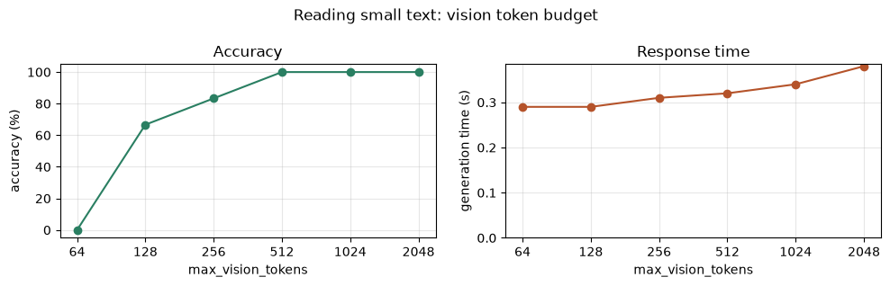
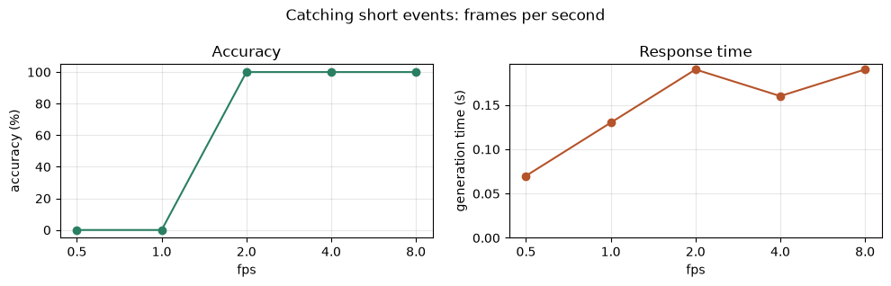

# Cosmos 3 Edge for First-Timers: The Settings That Change the Answer

A hands-on how-to for the NVIDIA Cosmos3-Edge reasoner on images and video, from your first call to a tuned setup. Every setting is measured for what it does to accuracy and response time.

[](https://colab.research.google.com/github/obiedeh/cosmos3-edge-first-timers-guide/blob/main/cosmos3_edge_first_timers_guide.ipynb)

**The companion guide.** [Cosmos Reason 2 for First-Timers](https://github.com/obiedeh/cosmos-reason2-first-timers-guide) runs the same tests on Cosmos Reason 2 (2B). The two can be read in either order.

## What one setting does

Two charts from the notebook, measured on `rtx-5090-workstation` on 2026-11-15.



Reading six small labels: the vision token budget takes the score from 0 of 6 to 6 of 6, at almost no cost in time.



Catching digits that flash on screen for half a second: below 2 frames per second the model never sees them.

## Why I built this

I wrote [the same kind of guide for Cosmos Reason 2](https://github.com/obiedeh/cosmos-reason2-first-timers-guide), the model behind my [Urban Edge Vision Analytics](https://github.com/obiedeh/urban-edge-vision-analytics) and [Physical AI Safety Observability](https://github.com/obiedeh/physical-ai-safety-observability) projects. NVIDIA has since released Cosmos 3, and its smallest model, Cosmos3-Edge, is the one sized for the boards I work on.

The settings I learned on Reason 2 do not all carry over. Three things were different:

- **Thinking is on by default.** A one-word question came back with a paragraph of reasoning in front of it until I switched it off.
- **Video costs more per frame.** Every frame gets its own tokens, so a budget that was enough for a clip on Reason 2 left each frame unreadable here.
- **4-bit loading returned no readable text.** It loaded without an error, and the output was symbols.

So I ran the same tests again on Cosmos3-Edge and wrote down what each setting does.

I built it for Google Colab on purpose, to make the model easier to learn and adopt. It runs in a browser with nothing to install on your own machine. It ran every cell on Colab's T4 and A100 GPU runtimes on 2026-11-15.

## Why Cosmos 3

Cosmos 3 is NVIDIA's newest family of world models for physical AI, released on Hugging Face on 2026-07-20. Each model has two parts. The **reasoner** reads text, images and video and answers in text. The **generator** produces video, images and robot actions. One architecture covers understanding, generation and action. Cosmos Reason 2 was a reasoning model only. This guide covers the reasoner only.

Three reasons I moved my test bench to it:

- **It is the current family.** NVIDIA now maintains the Cosmos Reason 2 repository in limited form, and its current cookbook and reasoner guides are written for Cosmos 3.
- **The smallest size is made for edge boards.** NVIDIA lists Jetson AGX Orin and Jetson AGX Thor among the targets for Cosmos3-Edge, the boards my projects run on.
- **It is easier to start with.** The model is not gated, so there is no license page to accept and no account is needed to download it. It is released under the [OpenMDW 1.1](https://openmdw.ai/license/1-1/) license, which NVIDIA states allows commercial use.

- NVIDIA's code, cookbook and model reference: [github.com/NVIDIA/cosmos](https://github.com/NVIDIA/cosmos)
- The reasoner prompt guide and the Transformers and vLLM references: [github.com/NVIDIA/cosmos-framework](https://github.com/NVIDIA/cosmos-framework)

## Cosmos 3 and Cosmos Reason 2: what is the same, what is different

If you know Cosmos Reason 2, most of what you know still applies. The table lists what carries over and what does not. Rows marked "measured" come from this guide and from [the Reason 2 guide](https://github.com/obiedeh/cosmos-reason2-first-timers-guide), on the same workstation. The rest is from NVIDIA's model cards and documentation.

| | Cosmos Reason 2 (2B) | Cosmos3-Edge reasoner |
|---|---|---|
| **Same** | | |
| Input and output | Text, images and video in, text out | Text, images and video in, text out |
| Prompt rules | Media before text, system prompt `You are a helpful assistant.` | The same |
| Answer formats | Boxes and points on a 0 to 1000 grid, timestamps for video, `<think>` tags | The same |
| Video frame rate NVIDIA recommends | 4 per second | 4 per second |
| NVIDIA's sampling values | temperature 0.7, top_p 0.8, top_k 20 (0.6, 0.95, 20 with thinking) | The same |
| Picture detail | One vision token per 32 x 32 pixel patch | The same |
| Loading and serving | `transformers` in Python, vLLM for an OpenAI-compatible server | The same |
| **Different** | | |
| Family | A reasoning model only, in 2B, 8B and 32B | Reasoner and generator in one model, in 4B, 16B and 64B |
| Built on | Qwen3-VL | A SigLIP2 vision encoder and a 28-layer language model |
| Access and license | Gated, NVIDIA Open Model License | Not gated, OpenMDW 1.1 |
| `transformers` release | 4.57.3, the version NVIDIA's sample pins | 5.x. This guide uses 5.23.0 |
| Thinking | Off unless you add an instruction to the prompt | On unless you switch it off in the chat template (measured, Part 9) |
| Video tokens | Two neighboring frames share one set of tokens | Every frame gets its own tokens, so a clip costs more (measured, Part 6) |
| Weights on the GPU, 16-bit | 4.3 GB (measured) | 4.9 GB (measured) |
| Speed on a 200-token description | 113 tokens a second (measured) | 147 tokens a second (measured) |
| 4-bit loading with `bitsandbytes` | Works, at a small cost in accuracy (measured) | Returns no readable text (measured, Part 16) |

### What it does better, and what it costs

From the identical tests in both guides (full table under "Against Cosmos Reason 2" below):

- **Better here:** faster per token; it did not describe objects that are not in the picture, where Reason 2 described a coffee cup that is not there; it scored 2 to 4 of 6 on the warehouse clip against 1 to 3 of 6; batching gave 1.6x against 1.5x.
- **Costs here:** about 0.6 GB more memory; 4-bit loading does not work; a video needs more tokens per frame; thinking must be switched off for short answers; at the smallest image budget it read 0 of 6 labels against 1 of 6; on the one-minute clip, splitting into short clips did worse than one call, the opposite of Reason 2.

These are small tests on one machine. They show where the two models behave differently. They do not rank them.

## The sizes, and why Edge

NVIDIA publishes three sizes on Hugging Face:

| Model | Parameters | NVIDIA's stated targets |
|---|---|---|
| [Cosmos3-Edge](https://huggingface.co/nvidia/Cosmos3-Edge) | 4 billion | Jetson AGX Orin, Jetson AGX Thor, RTX Pro 6000 |
| [Cosmos3-Nano](https://huggingface.co/nvidia/Cosmos3-Nano) | 16 billion | RTX Pro 6000, H100, B200 |
| [Cosmos3-Super](https://huggingface.co/nvidia/Cosmos3-Super) | 64 billion | H200, B200, GB200 |

The sizes and targets are NVIDIA's figures from their README, not measured here. The 4 billion counts both parts of the model. The reasoner alone, which is what `transformers` loads, is 2.44 billion parameters.

Why this guide uses Edge:

- **It fits the hardware a first-timer has.** See the hardware profile below.
- **It is the size made for edge boards**, which is where my projects run.
- **The method carries over.** The larger models load through a different class and will score differently. They are not measured in this guide.

## Hardware profile

Measured in this guide, on `rtx-5090-workstation` (RTX 5090, 32 GB), float16 weights:

| What | Measured |
|---|---|
| Download | about 7.7 GB of files; the reasoner uses part of it |
| Weights on the GPU | 4.9 GB |
| Peak during a single call | 4.9 to 5.8 GB, depending on the vision budget |
| Peak with eight questions batched | 6.7 GB |
| Peak with a second copy loaded (Part 16) | 10.0 GB, the highest in the run |
| Speed on a 200-token description | 147 tokens a second |
| Load time from a local disk | 2 seconds |

NVIDIA's own figures for the same reasoner on Jetson boards, from the model card. These were measured by NVIDIA with `transformers` in eager mode on an image prompt of 911 tokens, not by me:

| Board | Writing speed | One full request |
|---|---|---|
| Jetson AGX Thor T5000, 128 GB, MAXN | 42.6 tokens a second | 3.17 s |
| Jetson AGX Orin, 64 GB | 12.3 tokens a second | 10.81 s |

What NVIDIA lists as supported: Ampere, Hopper and Blackwell GPUs, on Linux, with BF16 as the only tested precision. Colab's free T4 is an older generation (Turing) that is not on that list and does not run BF16 natively, which is why the notebook loads float16. On this workstation float16 and BF16 gave the same scores (Part 16). The notebook ran every cell on a Colab T4 on 2026-11-15, and on a Colab A100 the same day.

## What it covers

| Part | Topic |
|---|---|
| 1 | Set up Colab, install, load the model, build the helpers |
| 2 | First image call and first video call |
| 3 | What is inside a call: messages, the prompt, tokens |
| 4 | `max_new_tokens`: output length and time |
| 5 | Vision token budget: image detail, accuracy and time. Cropping. |
| 6 | Video: `fps`, the shared frame budget, long video |
| 7 | Context window: counting what you send |
| 8 | Where the time goes: the first token against the rest |
| 9 | Thinking mode: on by default, accuracy against time |
| 10 | Sampling: `temperature`, `top_p`, `top_k`, `repetition_penalty`, `seed` |
| 11 | Prompt structure: media order and the system prompt, tested |
| 12 | Knowing when it is wrong: leading questions and answer agreement |
| 13 | Real footage check: a warehouse camera |
| 14 | Task gallery: NVIDIA's prompts on NVIDIA's footage |
| 15 | Several images, and follow-up questions |
| 16 | Speed and memory: batching, 16-bit formats and 4-bit loading |
| 17 | Streaming, and the same parameters on a vLLM server |
| 18 | A template for tuning on your own data |
| 19 | Cheat sheet, troubleshooting and sources |

Each of Parts 2 to 18 runs on its own after Part 1.

## Run it

1. Press the Colab button above and choose a GPU runtime.
2. Run all.

The model is not gated, so there is no license page to accept and no account is needed. It is released under the [OpenMDW 1.1](https://openmdw.ai/license/1-1/) license. A Hugging Face token is optional: add it as a Colab secret named `HF_TOKEN` and the download is faster.

The first run downloads about 7.7 GB of model files, and about 50 MB of NVIDIA's sample footage from NVIDIA's own sites. None of that media is stored in this repository.

## Models, versions and hardware

| Item | Value |
|---|---|
| Model | `nvidia/Cosmos3-Edge`, reasoner only, float16 weights, about 7.7 GB to download and 4.9 GB on the GPU |
| Library | `transformers==5.23.0`, with `accelerate` 1.15.0 and `bitsandbytes` 0.50.2 |
| Measured on | `rtx-5090-workstation`, Python 3.12.3, PyTorch 2.11.0 with CUDA 12.8, 2026-11-15 |
| Colab | T4 and A100 GPU runtimes, 2026-11-15: every cell ran on both; that output was not kept. Run again on 2026-11-18 on the T4 and on an A100 (80 GB): all 43 code cells with no errors on both. Records, with every output: [T4](records/cosmos3_edge_first_timers_guide.executed.colab-t4.2026-11-18.ipynb), [A100](records/cosmos3_edge_first_timers_guide.executed.colab-a100.2026-11-18.ipynb). The figures here are from `rtx-5090-workstation`. |
| Server tests (Part 17) | vLLM 0.33.0 on `rtx-5090-workstation`, 2026-11-15. Reference text in the notebook, not executed cells. The requests and replies are in [`records/server_tests/`](records/server_tests/). |

NVIDIA states that it tested the model in BF16 precision only. The notebook loads float16 so that it can run on GPUs without native BF16. On `rtx-5090-workstation` the two gave the same scores and the same speed (Part 16).

## How it works

Every call goes through one helper, `ask()`, so each setting under study is one named argument. The helper builds the conversation, prepares the inputs, generates, then records token counts, seconds and peak GPU memory. It switches thinking off unless you ask for it, and it returns the final answer separately from the thinking.

Accuracy is measured with tests that have a known answer:

- **Generated tests.** An image of six labeled boxes with printed codes, and a video that flashes digits in order. The right answer is known exactly, so a setting's effect shows up as a score.
- **NVIDIA's footage.** A warehouse camera clip and NVIDIA's task examples, with the answers checked by eye.

Two functions, `evaluate()` and `sweep()`, score any list of questions against any setting. Part 18 turns them into a template for your own cameras.

Video frames are read with OpenCV and passed to the processor with their timestamps. The media and most test questions are the same as in the Cosmos Reason 2 guide, so the two models can be compared.

## Measured results

All figures below come from one run on `rtx-5090-workstation` on 2026-11-15. The record is [`records/cosmos3_edge_first_timers_guide.executed.rtx-5090-workstation.2026-11-15.ipynb`](records/cosmos3_edge_first_timers_guide.executed.rtx-5090-workstation.2026-11-15.ipynb), the same notebook with its outputs. The full run took 171 seconds.

A second run from the same day is kept beside it. Every score in it is the same. Its timings are slower from the middle onward, because another job was using the workstation's CPU by then, so the timings below are from the first run only.

| Change | Before | After |
|---|---|---|
| Vision token budget raised from 64 to 512 (reading six labels) | 0 of 6 | 6 of 6 |
| Image read as two halves at 96 tokens each, against the whole image at 96 | 0 of 6 | 6 of 6 |
| Video frame rate raised from 1 to 2 frames per second (digit clip) | wrong | right |
| Video budget raised from 1024 to 2048 tokens (18 to 32 tokens per frame) | wrong, answered in words | right |
| One-minute clip: one call at 2 frames per second and 8192 tokens, against one call at 4 frames per second and 4096 | 9 digits returned, a made-up count | 19 of the 20 digits, in order |
| Thinking switched on for a digit-sum question | 3 output tokens, 0.11 s, wrong | 196 output tokens, 1.34 s, right |
| Five multi-step questions, thinking off against on | 2 of 5, 0.73 s | 4 of 5, 5.52 s |
| Thinking call stuck in a loop: NVIDIA's sampling values against greedy decoding | 1,000 tokens, no answer | an answer in 104 to 660 tokens |
| Batching eight questions in one call | 1.07 s | 0.66 s (1.6x), 6.7 GB peak |

Results that did not improve, kept because they are useful:

- **Splitting the long video did not beat one call.** Eight clips returned 25 digits for 20, with doubles where clips meet and an invented "2, 1, 0" at the end. Twelve clips returned 19 with digits lost and doubled. Eight clips at 128 tokens each returned 69 invented digits.
- **NVIDIA's thinking instruction added to the question** scored 3 of 5 against 4 of 5 for the template switch alone, and wrote more tokens. With the switch off, the instruction did not turn thinking on.
- **Thinking did not help on real footage.** The warehouse questions scored 4 of 6 with it and 4 of 6 without.
- **4-bit loading** through `bitsandbytes` cut the weights from 4.9 GB to 2.2 GB and read 0 of 6 labels at every budget. The output was symbols.
- **float16 against bfloat16** made no difference: the same scores, 147 against 145 tokens a second.
- **Sampling.** Reading codes stayed at 6 of 6 across five seeds with greedy decoding, with the values the model ships and with NVIDIA's values. At temperature 1.3 with `top_k` and `top_p` off, two of five runs dropped, to 2 and 5 of 6.
- **Media order and system prompt**: 10, 8, 8 and 9 of 12. Media first with the plain system prompt, NVIDIA's rule, scored highest.
- **Leading questions did not catch it.** On four questions about objects that are not in the picture, the model said each was absent, with or without an escape clause.
- **Answer agreement works as a warning.** Where sampled answers agreed, 4 of 4 were right. Where they scattered, 0 of 4 were right.
- **Real warehouse footage** scored 2 to 4 of 6 across every frame rate and budget tried. Asked about each person separately, the model said the second person wears a hard hat. They do not.
- **Comparing two images.** The model named the right box and gave the old and new codes the wrong way round.

## Against Cosmos Reason 2 (2B) on the same tests

Tests that are identical in both guides: the same media, question and settings. Reason 2 figures are from that guide's record of 2026-11-14 on the same workstation, with `transformers` 4.57.3.

| Test | Cosmos Reason 2 (2B) | Cosmos3-Edge reasoner |
|---|---|---|
| Weights on the GPU, 16-bit | 4.3 GB | 4.9 GB |
| Speed on a 200-token description | 113 tokens a second | 147 tokens a second |
| Reading six labels at 64 vision tokens | 1 of 6 | 0 of 6 |
| Reading six labels at 256 vision tokens | 6 of 6 | 5 of 6 |
| Digit clip at 1 and at 2 frames per second | wrong, right | wrong, right |
| Leading question about a coffee cup that is not there | describes a black cup | says there is no cup |
| Warehouse clip, six questions, across the grid | 1 to 3 of 6 | 2 to 4 of 6 |
| Batching eight questions | 1.5x, 6.0 GB peak | 1.6x, 6.7 GB peak |
| 4-bit loading | 1.7 GB, 4 of 6 labels at 256 tokens | 2.2 GB, no readable output |
| Twenty digits from the one-minute clip | all 20 with 8 clips | 19 at best, with one call |

These are small tests on one machine. They show where the two models behave differently. They do not rank them.

## Issues found and their causes

Kept as found. Nothing here was cleaned up to make the work look smoother.

| Issue | Cause | What I changed |
|---|---|---|
| A plain call returned a paragraph of reasoning before the answer | The chat template's `enable_thinking` switch is on unless set | `ask()` passes `enable_thinking=False` by default and `True` when `reasoning` is set |
| NVIDIA's "answer in this format" instruction did not make the model think | With the switch off the template closes the thinking block before the answer starts | The `reasoning` argument drives the template switch. The instruction is an optional extra (`reasoning="prompt"`) |
| Answers marked "cut off while thinking" that finished in 0.2 s | With thinking on, the model sometimes answers at once and stops without writing `</think>` | The helper now treats text with no `</think>` as the answer, unless the token limit was reached |
| A thinking call ran to the limit writing the same three sentences | Greedy decoding stuck in a repeating loop, which ran to the 1,000 token limit | Part 14 shows the loop and reruns the call with NVIDIA's sampling values, which finish |
| 4-bit loading returned symbols | Not established. NVIDIA lists BF16 as the only tested precision | Kept as a row in Part 16 so the reader sees it |
| The digit clip was unreadable at the helper's default budget | Each frame is tokenized separately, so 1,024 tokens over 47 frames is 18 per frame | Video questions on that clip use 2,048 tokens. Part 6 teaches tokens per frame |
| One call on the one-minute clip returned "1, 2, 3 ... 9" | 4,096 tokens over 244 frames is 15 per frame | Added a row at 2 frames per second and 8,192 tokens, which reads 19 of 20 |
| The first scorer counted long answers as right | It accepted any answer that contained the right number among others | A number is now scored strictly, and the questions ask for the number only |
| Direct answers that explain instead of giving a number | With thinking off, the model answered two "number only" questions in sentences | Left in. One is cut at 40 tokens, and both are scored wrong |
| The two-image answer was cut off | The model described both images before answering | The question now ends with "Answer in one sentence" |
| vLLM 0.33 refused per-request `fps` and image size | Per-request media settings are disabled by default | Start the server with `--trust-request-mm-kwargs` |
| `fps` inside `mm_processor_kwargs` failed with a processor error on vLLM 0.33 | Not established | Send `media_io_kwargs={"video": {"fps": N}}` |
| The first vLLM install could not serve the model | The installer resolved to vLLM 0.24.0, which has no Cosmos3-Edge support, and upgrading in place left mismatched CUDA builds | A clean environment with `vllm==0.33.0` |

## What is not established

- **The Colab runs are not compared line by line.** The T4 and A100 runs of 2026-11-18 are kept ([T4](records/cosmos3_edge_first_timers_guide.executed.colab-t4.2026-11-18.ipynb), [A100](records/cosmos3_edge_first_timers_guide.executed.colab-a100.2026-11-18.ipynb)); the runs of 2026-11-15 were not. One difference is visible: in Part 9 one question with thinking on ran to the 800-token limit before answering on both Colab runtimes, and finished on both workstation runs. All runs load float16, so precision is not the cause; the Colab runtimes use a newer PyTorch (2.14) than the workstation (2.11). Why is not established.
- **These are small tests.** Each accuracy test has 4 to 12 questions. They show an effect. They are not benchmarks.
- **Timings are from an RTX 5090.** Expect slower numbers on other GPUs.
- **One machine.** Two runs gave the same scores. Only the first has clean timings.
- **Why 4-bit loading fails** is not known.
- **Server notes apply to vLLM 0.33.0 only.**
- **The comparison with Cosmos Reason 2** uses two different `transformers` releases, one for each model.
- **Cosmos3-Nano, Cosmos3-Super and the generator** are not covered.

## Editing the notebook

The cells live as plain text in `notebook_src.txt`. A line that is exactly `#%% md` or `#%% code` starts a new cell.

```bash
pip install -r requirements-dev.txt
python build_notebook.py     # rebuilds the notebook from notebook_src.txt
pytest                       # checks the notebook matches its source, and repository hygiene
```

## About

Obinna Edeh, Head of Physical AI Lab, [EmbodiedEdge](https://embodiededge.ai). I design and build Physical AI and edge AI systems, and prove them on real robots and hardware. I run Cosmos Reason 2 and Cosmos3-Edge on a Jetson AGX Thor.

- GitHub: [obiedeh](https://github.com/obiedeh)
- LinkedIn: [Obinna Edeh](https://www.linkedin.com/in/obinna-edeh-206306137/)

This is independent work. It is not affiliated with or endorsed by NVIDIA.

## License

Code and text are under the Apache License 2.0. See [LICENSE](LICENSE). The model and the sample footage belong to NVIDIA and carry their own licenses.

## Change log

See [CHANGELOG.md](CHANGELOG.md).
